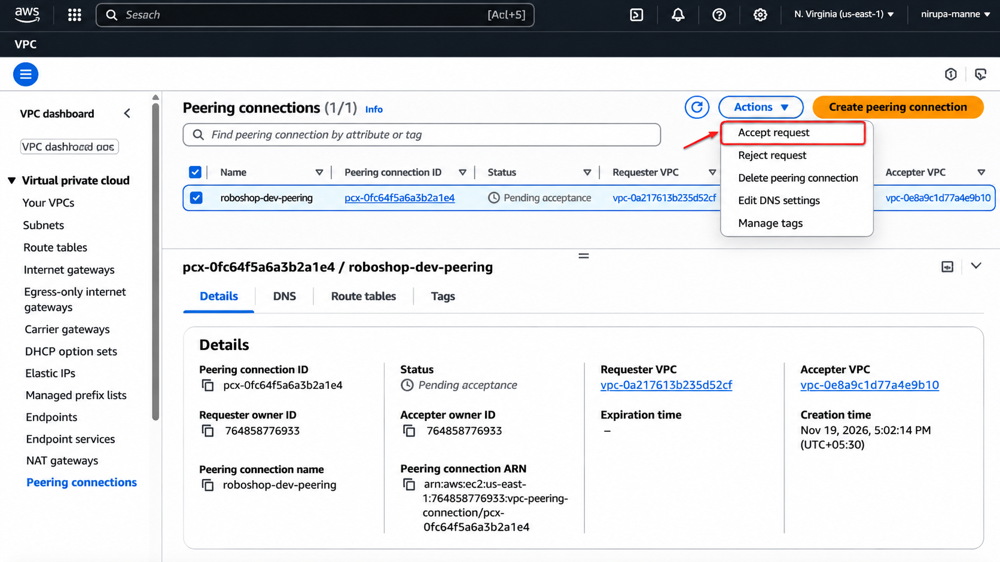

# AWS-VPC-Peering

## 1. What is VPC Peering?

VPC Peering is a networking connection between two Virtual Private Clouds (VPCs) in AWS.

It allows resources in one VPC to communicate with resources in another VPC using private IP addresses.

### Real-time example

Imagine two villages. If people from Village 1 want to travel to Village 2, they need a road connecting both villages.

Similarly, if two VPCs need to communicate, we establish a VPC Peering connection.

## 2. Why do we need VPC Peering?

For example:

- VPC-1 contains an application server.
- VPC-2 contains a database server.
- The application server needs to communicate with the database server.

Using VPC Peering, both servers can communicate privately without exposing the database to the public internet.

## 3. VPC CIDR Configuration

For this practical, we are using two VPCs with different CIDR blocks.

| Configuration | VPC-1 | VPC-2 |
|---|---|---|
| VPC Name | roboshop-dev | roboshop-dev-default |
| CIDR | 10.0.0.0/16 | 10.1.0.0/16 |
| Region | us-east-1 | us-east-1 |

**Important:** Both VPCs must have non-overlapping CIDR blocks.

## 4. VPC Peering Prerequisites

1. Both VPCs should be created.
2. Both VPCs must have non-overlapping CIDR blocks.
3. The user should have the required AWS permissions.
4. The accepter must accept the peering request.
5. Route tables must be configured on both sides.
6. Security groups must allow the required traffic.

### Different VPC Peering scenarios

- Same account, same region – Supported.
- Same account, different regions – Supported.
- Different accounts, same region – Supported.
- Different accounts, different regions – Supported.

## 5. Step-by-Step Implementation

### Step 1: Identify VPC-1

We already created a VPC named `roboshop-dev`.

1. Open AWS Management Console.
2. Search for VPC.
3. Select Your VPCs.
4. Identify roboshop-dev.
5. Note the VPC ID and CIDR block.

### Step 2: Identify VPC-2

Create or identify the second VPC.

Example:

- Name: roboshop-dev-default
- CIDR: 10.1.0.0/16
- Region: us-east-1

Make sure both VPCs have different CIDR blocks.

### Step 3: Create VPC Peering Connection

1. Open the VPC dashboard.
2. Select Peering Connections.
3. Click Create Peering Connection.
4. Enter the peering connection name.
5. Select the requester VPC.
6. Select the accepter VPC.
7. Select the AWS account and region.
8. Click Create Peering Connection.

The peering connection will initially show Pending Acceptance.

### Step 4: Accept the Peering Request

1. Open Peering Connections.
2. Select the newly created connection.
3. Click Actions.
4. Select Accept Request.
5. Confirm acceptance.

After successful acceptance, the status changes to Active.

### Step 5: Configure Route Table in VPC-1

1. Open the VPC dashboard.
2. Select Route Tables.
3. Find the route table associated with the subnet containing the EC2 instance in VPC-1.
4. Select Edit Routes.
5. Click Add Route.

Enter:

Destination: 10.1.0.0/16

Target: VPC Peering Connection

Select the newly created peering connection.

6. Save Changes.

**Explanation:** We are telling VPC-1 that traffic going to VPC-2 should travel through the VPC Peering connection.

### Step 6: Configure Route Table in VPC-2

Now configure the reverse route.

1. Open Route Tables.
2. Select the route table associated with the subnet containing the EC2 instance in VPC-2.
3. Click Edit Routes.
4. Click Add Route.

Enter:

Destination: 10.0.0.0/16

Target: VPC Peering Connection

Select the same peering connection.

5. Save Changes.

**Explanation:** Now VPC-2 knows how to send traffic back to VPC-1.

### Step 7: Configure Security Groups

Update the EC2 security groups to allow the required inbound traffic.

Example:

VPC-1 security group:
- Allow required traffic from 10.1.0.0/16.

VPC-2 security group:
- Allow required traffic from 10.0.0.0/16.

Allow only the required ports and protocols.

### Step 8: Test Connectivity

1. Launch one EC2 instance in VPC-1.
2. Launch another EC2 instance in VPC-2.
3. Connect to the first EC2 instance.
4. Test connectivity to the second instance using its private IP address.

Command:

```bash
ping <VPC-2-EC2-Private-IP>
```

For application port testing:

```bash
nc -zv <VPC-2-EC2-Private-IP> 8080
```

Note: ICMP must be allowed for ping to work. Replace port 8080 with the actual application port.

If the required routing and security configurations are correct, communication will work using private IP addresses.

## 6. Final Output

After completing all the steps:

- Both VPCs should have an active peering connection.
- VPC-1 should have a route to VPC-2.
- VPC-2 should have a route to VPC-1.
- Security groups should allow the required traffic.
- EC2 instances should communicate using private IP addresses.

## 7. Important Points

1. VPC Peering is not transitive.
2. CIDR blocks should not overlap.
3. Route tables must be updated on both sides.
4. Security groups should allow the required traffic.
5. Peering does not automatically provide internet access.
6. VPC Peering supports same-region and cross-region connections.
7. VPC Peering supports same-account and cross-account connections.

## 8. Interview Questions

**Q1. What is VPC Peering?**

VPC Peering is a private networking connection between two VPCs that allows resources to communicate using private IP addresses.

**Q2. Can we connect two VPCs with the same CIDR block?**

No. VPC Peering does not support overlapping CIDR blocks.

**Q3. Is VPC Peering transitive?**

No. If VPC-1 is connected to VPC-2 and VPC-2 is connected to VPC-3, VPC-1 cannot automatically communicate with VPC-3 through VPC-2.

**Q4. Do we need to update route tables?**

Yes. We need to configure routes on both VPCs.

**Q5. Do we need to accept the peering request?**

Yes. The accepter must accept the peering request.

**Q6. Can we connect VPCs in different regions?**

Yes. AWS supports inter-region VPC Peering.

**Q7. Can we connect VPCs from different AWS accounts?**

Yes. The accepter account must accept the request.

**Q8. Does VPC Peering provide internet connectivity?**

No. VPC Peering provides private connectivity between the two VPCs. It does not act as an internet gateway.

---

## 9. Screenshots

### Accepting the Peering Request



### Attaching route tables in peering connection


### Final output


---
